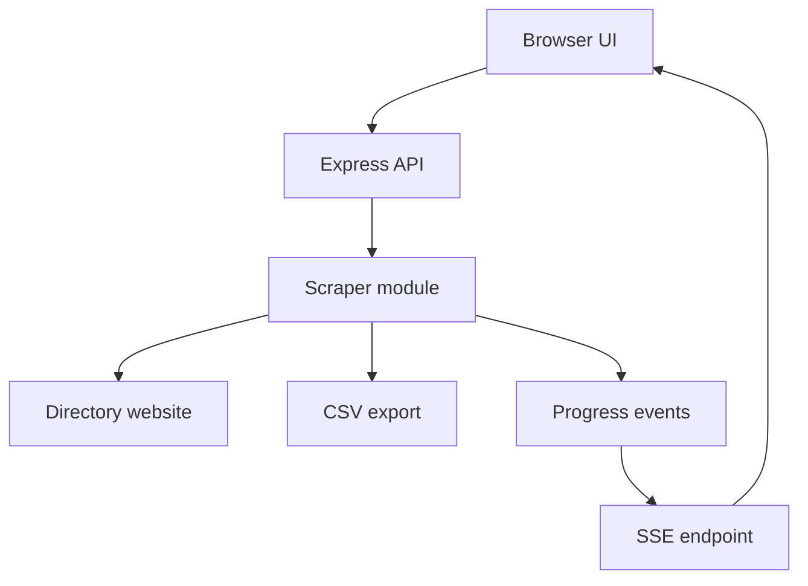

# TrustedTrader Business Directory Scraper

A Node.js and Express application that collects publicly visible business-directory listing data and exports it as a CSV for downstream directory imports.

The project combines HTML parsing, asynchronous scraping, a browser interface, and Server-Sent Events (SSE) for live job progress.

## Features

- Filter collection by region or scan the directory's available regions.
- Parse listing details into a structured CSV.
- Stream category, listing, and progress events to the browser with SSE.
- Display job progress and provide a CSV download when processing completes.
- Use configurable request delays, concurrency, and retry backoff in the scraper module.

## Architecture



## Stack

- Node.js with ES modules
- Express
- Axios and Cheerio
- JSON2CSV
- Vanilla JavaScript and EventSource

## Run locally

```bash
git clone https://github.com/Novavamp/TrustedTrader-Scraper.git
cd TrustedTrader-Scraper
npm install
npm start
```

Open `http://localhost:4000`.

## Usage

1. Enter a region, or leave it blank to use the directory-wide category index.
2. Enter a result limit. Use `0` for no configured limit.
3. Start the job and monitor its progress.
4. Download the generated CSV when complete.

## CSV fields

The scraper maps available listing information into fields intended for directory imports. Missing source fields may be blank. The exact available fields depend on the listing page.

## Important operational notes

This repository is an educational project and has not been hardened as a public multi-user scraping service. The current server keeps job state in memory, exposes job events by identifier, serves generated files from a static downloads route, and does not provide user authentication or durable job storage. Do not deploy it to an untrusted public network without adding authentication, per-user authorization, private download handling, request validation, rate limits, durable job state, and reliable cancellation.

The scraper should be used only where collection is permitted. Respect the target site's terms, robots guidance, rate limits, and applicable privacy and data-protection requirements.

## Development

```bash
npm test
```

The test command uses Node's built-in test runner. Add focused tests when changing parsing, job lifecycle, or CSV behaviour.
